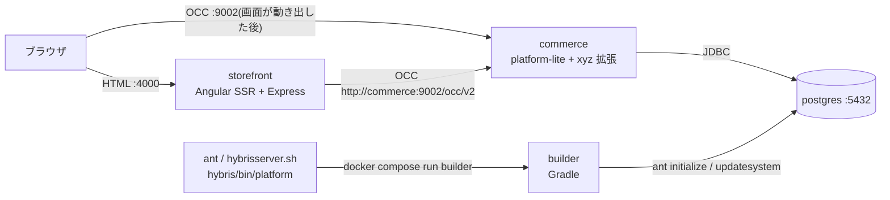

# 機能の設計書: 全体の構成(チケット番号なし。基盤の設計)

読み手: 新しく入った開発者、設計をレビューする人(cs-architect、cs-auditor)
状態: 合意済み(2026-10-20)

パスの書き方: リポジトリの最上位からの相対で書く。ただし `core-customize/hybris/bin/` の下は頭を省いて `platform/`、`platform-lite/`、`custom/` から書く。行番号は 2026-10-20 時点。

## 要約(用語なし、3 行まで)
お店の画面を作るサーバー、商品や注文を扱うサーバー、データベースの 3 つを、手元のパソコンで箱(コンテナ)に入れて動かす。
画面のサーバーは、決まった形の窓口だけを通して商品や注文のサーバーに話しかける。
商品や注文のサーバーは本物の製品ではなく、同じ形に作った小さな作り物である。

## 何を作るか
この文書は、XYZ Store の EC サイトの全体の形を決める。個々の機能の作り方は、ほかの設計書に書く(一覧は `docs/README.md`)。

### 部品と役目
| 部品 | 中身 | 待ち受け | 根拠 |
|---|---|---|---|
| storefront | Angular 21 の SSR アプリ(SSR = サーバーで HTML を作ってから返すこと)。Express の上で動く | :4000 | (ソース: `docker-compose.yml:49-62`、`storefront/src/server.ts:62-71`) |
| commerce | 疑似 Commerce。Spring Boot 3.5 の 1 つの jar(`build/libs/commerce.jar`)で、OCC(SAP Commerce の REST API の決まった形)を出す | :9002 | (ソース: `docker-compose.yml:36-47`、`platform/build.gradle:4-9,101-104`) |
| postgres | PostgreSQL 16。DB 名・利用者は `hybris` | :5432 | (ソース: `docker-compose.yml:6-20`) |
| builder | `ant` の中身を動かす Gradle のコンテナ。`--profile tools` のときだけ使う | なし | (ソース: `docker-compose.yml:22-34`) |

### 本物と同じところ・違うところ
| 項目 | この案件(疑似) | 本物の SAP Commerce / Composable Storefront | 根拠 |
|---|---|---|---|
| 拡張(extension = 機能を足す単位のフォルダ)の形 | `xyzcore` / `xyzfacades` / `xyzocc` を `localextensions.xml` に並べる | 同じ | (ソース: `core-customize/hybris/config/localextensions.xml:10-14`) |
| 型の定義 | `*-items.xml` から Model を生成し、表を作る | 同じ考え方。生成の仕組みは別物 | (ソース: `platform/build.gradle:78-89`) |
| プラットフォーム | `platform-lite`(Spring Boot + JdbcTemplate で自作) | 本物の platform と標準拡張 | (ソース: `platform-lite/extensioninfo.xml:2-5`) |
| DB | PostgreSQL 16 | 本番は SAP HANA。DB の違いは今回の目的に関係しない | (推論) |
| 商品検索 | FlexibleSearch を SQL に直して検索(ADR 0003) | Solr | (ソース: `platform-lite/resources/platformlite-spring.xml:87-92`) |
| 認証 | メモリに持つトークン(サーバーを止めると消える) | authorizationserver(OAuth2) | (ソース: `platform-lite/src/de/hybris/platform/lite/web/OAuthTokenStore.java:9-12`) |
| フロントのライブラリ | 自作の `xyz-storefront-lib`(`@xyz/storefront`) | `@spartacus/*` | (ソース: `storefront/tsconfig.json:15-19`) |
| コマンド | `ant clean all` などの名前は同じ。中は Docker の Gradle | 本物の ant | (ソース: `platform/ant:2-5`) |

### 作らないこと
- BFF(画面専用の中継サーバー)や Next.js などの別のフロント。ストアフロントは OCC だけを呼ぶ(ソース: `CLAUDE.project.md:8-9`)。
- 本物の SAP のソースや `@spartacus/*` を入れること(ソース: `CLAUDE.project.md` の前提、ADR 0001)。
- 本番の環境(CCv2)へのデプロイ。`core-customize/manifest.json` は形だけ合わせてある(ソース: `core-customize/manifest.json:1-43`)。

## 実現の仕方の仕分け
- バックエンドは「OCC の拡張(Commerce 側)」で作る。標準の動きを変えるときは `platform-lite` を直さず、自社の拡張から bean の alias、`modifyPopulatorList`、自分の `*-beans.xml` と `fieldSetLevelMapping` で足す(ソース: `custom/xyzfacades/resources/xyzfacades-spring.xml:23-30`、`custom/xyzocc/web/webroot/WEB-INF/config/xyzocc-web-spring.xml:25-35`)。
- 画面は「ストアフロントのコード」と「CMS」で作る。ページの中身(どのスロットに何を置くか)は CMS のデータで決まる(ソース: `storefront/src/app/app-routing-module.ts:5-6`)。
- 理由: 本物の案件と同じ置き場所と手順にして、作業の量を本物に近づけるため(ADR 0001)。

## 流れ(1 段 1 行。各段の責任)
ブラウザが `/product/XYZ-000001` を開いたときの流れ。

| 段 | ファイル(行) | クラス / 関数 | 責任 |
|---|---|---|---|
| 1 | `storefront/src/server.ts:49-56` | Express + `AngularNodeAppEngine` | すべての URL を Angular の SSR に渡す。`/occ` は Angular に回さず 404 を返す(31-33 行) |
| 2 | `storefront/src/app/app-routing-module.ts:6` | `PageLayoutComponent` | どの URL も同じ部品で描く。中身は CMS で決まる |
| 3 | `storefront/src/app/xyz-storefront-lib/cms/page/page-context.service.ts:22-36` | `PageContextService.fromUrl` | URL から「どの種類のどのページか」を決める(`/product/:code` → ProductPage) |
| 4 | `storefront/src/app/xyz-storefront-lib/cms/occ/occ-cms-page.adapter.ts:14-20` | `OccCmsPageAdapter.load` | OCC の `GET /cms/pages` を呼ぶ |
| 5 | `storefront/src/app/app.module.server.ts:16` | `provideConfig` | SSR のときだけ、OCC の接続先を環境変数 `OCC_BASE_URL`(Docker では `http://commerce:9002`)にする |
| 6 | `platform-lite/src/de/hybris/platform/lite/config/OccWebConfiguration.java:56-68` | `OccWebConfiguration` | Controller に `/occ/v2` を付け、`OccContextInterceptor` を通す |
| 7 | `platform-lite/src/de/hybris/platform/commercewebservices/core/filter/OccContextInterceptor.java:47-82` | `OccContextInterceptor.preHandle` | `{baseSiteId}`、言語、通貨、`{userId}` から、今のサイトと利用者を決める |
| 8 | `platform-lite/src/de/hybris/platform/commercewebservices/core/v2/controller/CmsPagesController.java:32-38` | `CmsPagesController.getPage` | Facade を呼び、WsDTO(OCC の応答の形のクラス)にする |
| 9 | `platform-lite/src/de/hybris/platform/servicelayer/search/impl/DefaultFlexibleSearchService.java:55-60` | `DefaultFlexibleSearchService.search` | FlexibleSearch を SQL に直して PostgreSQL に流す(読み替えは `lite/search/FlexibleSearchTranslator.java:23-31`) |

### 図

- ブラウザからの OCC の呼び出しは `http://localhost:9002` に向く(ソース: `storefront/src/app/spartacus/spartacus-configuration.module.ts:9-14`)。
- 画像の URL の頭は SSR でもブラウザから届く `http://localhost:9002` のままにする(ソース: `storefront/src/app/xyz-storefront-lib/occ/default-occ-config.ts:48-50`、`storefront/src/app/app.module.server.ts:8-11`)。

### 疑似 Commerce の起動の仕方(動き方の切り替え)
`commerce.jar` は引数 `--hybris.mode` で動きを変える(ソース: `platform-lite/src/de/hybris/platform/lite/HybrisLiteApplication.java:13-47`)。

| mode | 何をするか | 呼ぶコマンド |
|---|---|---|
| `server`(既定) | OCC を :9002 で出す | `./hybrisserver.sh`(`docker compose up -d commerce`) |
| `initialize` | 全部の表を消して作り直し、ImpEx を入れる | `./ant initialize` |
| `update` | 足りない表と列を足し、必須データを入れる | `./ant updatesystem` |
| `import` | 1 つの ImpEx を入れる | `./ant importImpex -Dresource=...` |

## 使う API
- OCC の約束ごとと 50 本の一覧: `docs/design/occ-api.md`
- 正式な仕様: `api/occ-openapi.yaml`(50 本。operationId の数で確かめた)(実測: `grep -c operationId api/occ-openapi.yaml` → 50)

## SSR での扱い
- すべての URL を要求ごとに SSR で描く。事前描画(Prerender)はしない。商品や在庫が変わるため(ソース: `storefront/src/app/app.routes.server.ts:3-9`)。
- ブラウザ側の Angular は SSR の HTML を引き継ぐ(hydration、`withEventReplay` 付き)(ソース: `storefront/src/app/app-module.ts:11`)。
- SSR を受け付けるホスト名は `localhost` と `127.0.0.1` だけ(ソース: `storefront/angular.json:44-49`)。
- 詳しい決まりは `docs/design/storefront.md` の「SSR での扱い」。

## 翻訳キーと CMS
全体の設計なので該当なし。翻訳は `docs/design/storefront.md`、CMS のデータは `docs/design/data-model.md` に書く。

## テスト
| 段階 | 何を確かめるか | 文書 |
|---|---|---|
| `ant unittests` / `ant integrationtests` | 拡張の Service、Populator、インターセプター | `docs/design/testing.md` |
| `node tools/occ-smoke.mjs` | OCC の 50 本が期待の状態コードを返す | 同上 |
| Playwright(real / mock) | 検索、商品詳細、カート、チェックアウトの 4 画面 | 同上 |

## 根拠の確かさ
- (推論): DB が HANA でなく PostgreSQL であることは、開発の手順とトークンの量にほぼ影響しない。
- (推論): 本物では、プラットフォームのソースや jar を読みに行く、ビルドのログが長い、起動が遅い分だけ、作業の量が増える。
- (未確認): 本物の CCv2 で同じ `manifest.json` が通るか。CCv2 の担当に確かめる。
