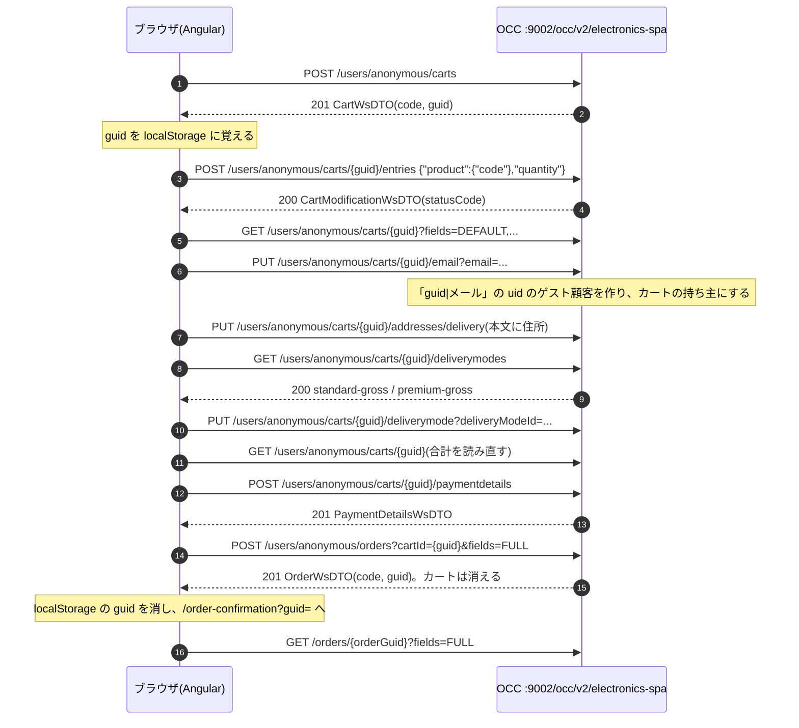

# 機能の設計書: ゲストのチェックアウト(チケット番号なし。基盤の設計)

読み手: カートと購入の流れを触る人(cs-frontend、cs-backend)、E2E を書く人(cs-qa)
状態: 合意済み(2026-10-20)

パスの書き方: リポジトリの最上位からの相対。ただし `core-customize/hybris/bin/` の下は頭を省いて `platform-lite/` から、ストアフロントの疑似ライブラリは `lib/`(= `storefront/src/app/xyz-storefront-lib/`)と書く。行番号は 2026-10-20 時点。

## 要約(用語なし、3 行まで)
会員登録をしない人が、商品をかごに入れて、届け先と届け方と支払いを入れて注文を確定するまでの流れ。
かごは、ブラウザに覚えさせた長い番号で見分ける。
値段は消費税込みで、税の額は合計から逆算して出す。

## 何を作るか
- ゲスト(ログインしない人)の購入を、商品詳細 → カート → チェックアウト(1 ページ)→ 注文確認の 4 画面で通す(ソース: `storefront/e2e/checkout.spec.ts:5-37`)。
- ストアフロントは今、ゲストだけを扱う。`ActiveCartService` の利用者は常に `anonymous`(ソース: `lib/cart/facade/active-cart.service.ts:19`)。
- 作らないこと: ログインした人の購入画面、住所録、複数の支払い方法、本物の決済。OCC 側はログインした人の購入にも対応している(ソース: `tools/occ-smoke.mjs:86-111`)。ADR 0006。

## 実現の仕方の仕分け
- 画面: ストアフロントのコード(`CheckoutComponent`、`OrderConfirmationComponent`。CMS では `CMSFlexComponent` の flexType)(ソース: `lib/cms-components/cms-components.module.ts:61-63`、`tools/generate-sampledata.mjs:353-357`)。
- 処理: 標準の OCC(`CartsController`、`OrdersController`)。自社の拡張はしていない。

## 流れ(1 段 1 行。各段の責任)
### 図

(ソース: `lib/occ/default-occ-config.ts:22-34`、`lib/cart/store/cart.effects.ts:24-86`、`lib/checkout/facade/checkout.service.ts:23-49`)

### 段ごとの責任
| 段 | ファイル(行) | クラス / 関数 | 責任 |
|---|---|---|---|
| 1 | `lib/cms-components/product/product-details.component.ts:45` | `addToCart` | 「カートに入れる」を受ける |
| 2 | `lib/cart/facade/active-cart.service.ts:52-62` | `addEntry` | カートが無ければ作る action、あれば明細を足す action を出す |
| 3 | `lib/cart/store/cart.effects.ts:25-42` | `createCart$` | カートを作り、続けて明細を足す。ゲストは guid、ログインした人は code を cartId に使う |
| 4 | `lib/cart/facade/active-cart.service.ts:95-108` | `initOnce` | ブラウザでだけ、guid を localStorage(`xyz-anonymous-cart-guid`)から読み、変わったら書く |
| 5 | `lib/cms-components/checkout/checkout.component.ts:91-97` | `submitAddress` | メールを付けてから届け先を送り、配送方法の一覧を受け取る(国は JP 固定) |
| 6 | 同 99-101 | `selectDeliveryMode` | 配送方法を決め、カートを読み直す |
| 7 | 同 103-107 | `submitPayment` | 支払いを送り、続けて注文を確定し、注文確認へ移る |
| 8 | `lib/checkout/facade/checkout.service.ts:40-45` | `placeOrder` | 確定したらカートを忘れる(`ActiveCartService.clear`) |
| 9 | `lib/cms-components/checkout/order-confirmation.component.ts:26-32` | `OrderConfirmationComponent` | `?guid=` の注文を出す |
| 10 | `platform-lite/src/de/hybris/platform/commercewebservices/core/v2/helper/GuestCustomerHelper.java:25-39` | `assignGuest` | uid `<カートの guid>|<メール(小文字)>` の顧客を作り、カートの持ち主にする |
| 11 | `platform-lite/src/de/hybris/platform/commercefacades/order/impl/DefaultCheckoutFacade.java:38-56` | `setDeliveryAddress` | ゲストは住所を新しく作ってカートに付ける。ログインした人は `addressId` で住所録から選べる |
| 12 | `platform-lite/src/de/hybris/platform/commerceservices/order/impl/DefaultCommerceCheckoutService.java:44-54` | `setDeliveryMode` | ストアが扱わない配送方法は `CommerceCartModificationException`(400 `CartError`) |
| 13 | 同 56-68 | `setPaymentInfo` | カード番号は 12〜19 桁の数字だけ受ける。下 4 桁だけを残し、`名義|************1234|月|年` の形で持つ |
| 14 | 同 70-124 | `placeOrder` | 明細・届け先・配送方法・支払いのどれかが無ければ `InvalidCartException`(400 `InvalidCartError`)。注文を作り、カートを消す |

### カートの見分け方(guid と code)
| 項目 | code | guid |
|---|---|---|
| 形 | `00100000-ab12` のような番号(8 桁 + `-` + 4 文字) | UUID |
| 作り方 | カートの件数 + 100000 を 8 桁にし、乱数 4 文字を付ける | `UUID.randomUUID()` |
| 使う人 | ログインした人(code でも guid でも引ける) | ゲスト(guid だけ) |

(ソース: `platform-lite/src/de/hybris/platform/commerceservices/order/impl/DefaultCommerceCartService.java:33-77`)

- ゲストのときは guid で引き、持ち主が `anonymous` か「`|` を含む uid」(ゲスト顧客)のカートだけを使える。それ以外は 400 `CartError`(reason `notFound`)(ソース: `platform-lite/src/de/hybris/platform/commercefacades/order/impl/DefaultCartFacade.java:27-38`)。
- ログインした人のときは「code か guid が合い、持ち主が本人」のカートを引く(ソース: `DefaultCommerceCartService.java:64-70`)。
- 注文の code は `order-w000001-ab12` の形。サンプルデータの `order-000001` とぶつからないように `w` を付ける(ソース: `DefaultCommerceCheckoutService.java:126-134`)。
- ゲストの注文は `GET /orders/{guid}` で、guid を知っている人なら誰でも見られる(ソース: `platform-lite/src/de/hybris/platform/commercewebservices/core/v2/controller/OrdersController.java:66-71`)。

### 数量の決まり
- 1 明細の上限は 999。在庫があれば在庫数まで。上限を超えた分は入れず、`statusCode` を `lowStock` にする。1 つも入らなければ `noStock`(ソース: `DefaultCommerceCartService.java:86-150`)。
- 同じ商品をもう一度入れると、同じ明細の数量が増える(ソース: 同 93-108 行)。
- 数量を 0 にすると明細を消す(ソース: 同 130-136 行、`platform-lite/src/de/hybris/platform/commercewebservices/core/v2/controller/CartsController.java:107-126`)。

### 値段と税の出し方
`DefaultCalculationService.calculate` が、明細を変えたとき・届け先や配送方法を変えたときに毎回計算し直す(ソース: `platform-lite/src/de/hybris/platform/order/impl/DefaultCalculationService.java:22-49`、`DefaultCommerceCheckoutService.java:28-54`)。

| 項目 | 出し方 | 根拠 |
|---|---|---|
| 明細の単価 | 今の通貨の価格のうち、最小数量 1 以下の行の一番安いもの | (ソース: `platform-lite/src/de/hybris/platform/commerceservices/price/impl/DefaultCommercePriceService.java:15-23`) |
| 明細の合計 | 単価 × 数量を、通貨の桁(JPY は 0 桁)で四捨五入 | (ソース: `DefaultCalculationService.java:35-36`、`platform-lite/src/de/hybris/platform/servicelayer/i18n/impl/DefaultCommonI18NService.java:97-100`) |
| 小計 | 明細の合計の和 | (ソース: `DefaultCalculationService.java:37,42`) |
| 送料 | 配送方法の `cost`(通常 500 円、お急ぎ 1,200 円)。未選択なら 0 | (ソース: 同 40 行、`tools/generate-sampledata.mjs:116-117`) |
| 合計 | 小計 + 送料。税込み(gross) | (ソース: `DefaultCalculationService.java:41-46`) |
| 税 | 合計 × 10 / 110(内税。送料にもかかる) | (ソース: 同 12-14,45 行、`platform-lite/resources/platformlite-spring.xml:99`) |

例: 3,980 円の商品 2 点 + 通常配送 → 小計 7,960 円、合計 8,460 円、税 769 円(8,460 × 10 / 110 = 769.09… を四捨五入)(推論。上の式から計算)。
- 価格が無い商品は `CalculationException` → 400 `CartError`(ソース: `DefaultCalculationService.java:29-34`、`DefaultCommerceCartService.java:164-175`)。
- OCC の応答の `totalPriceWithTax` には合計(税込み)がそのまま入る(ソース: `platform-lite/src/de/hybris/platform/commercefacades/order/converters/populators/AbstractOrderPopulator.java:47-49`)。

## 使う API
| API | 端点の名前(`lib/occ/default-occ-config.ts`) |
|---|---|
| POST `/users/{userId}/carts` | `createCart` |
| GET `/users/{userId}/carts/{cartId}` | `cart` |
| POST / PATCH / DELETE `.../entries` | `addEntries` / `updateEntries` / `removeEntries` |
| PUT `.../email` | `cartEmail` |
| PUT `.../addresses/delivery` | `setDeliveryAddress` |
| GET `.../deliverymodes`、PUT `.../deliverymode` | `deliveryModes` / `setDeliveryMode` |
| POST `.../paymentdetails` | `paymentDetails` |
| POST `/users/{userId}/orders?cartId=` | `placeOrder` |
| GET `/orders/{guid}` | `guestOrder` |

約束ごとは `docs/design/occ-api.md`、正式な形は `api/occ-openapi.yaml`。

## SSR での扱い
- チェックアウトの画面も SSR で描くが、カートは SSR では読まない。フォームと合計はブラウザで動き出してから出る(ソース: `lib/cart/facade/active-cart.service.ts:95-99`)。
- カートの guid は localStorage に持つので、`isPlatformBrowser` の外で触らない(ソース: `lib/cart/facade/active-cart.service.ts:80-82`)。
- チェックアウトと注文確認のページは利用者ごとに違うので、CDN などでキャッシュしない(推論)。

## 翻訳キーと CMS
| キー / コンポーネント | ja | en |
|---|---|---|
| `checkout.*`(title、email、lastName、firstName、postalCode、town、line1、next、deliveryAddress、deliveryMode、payment、cardHolder、cardNumber、expiryMonth、expiryYear、placeOrder、orderConfirmation、orderNumber) | `storefront/src/assets/i18n/ja/common.ts` | `storefront/src/assets/i18n/en/common.ts` |
| CMS: `CheckoutComponent`(ページ `checkout`、ラベル `/checkout`、BodyContent) | — | — |
| CMS: `OrderConfirmationComponent`(ページ `orderConfirmation`、ラベル `/order-confirmation`) | — | — |

(ソース: `lib/cms-components/checkout/checkout.component.ts:17-61`、`tools/generate-sampledata.mjs:353-357`)

## テスト
- E2E: `storefront/e2e/checkout.spec.ts`(real と mock の両方。`@mock`)(ソース: 同 5 行)。
- OCC: `tools/occ-smoke.mjs` の「ゲストの購入」(ソース: `tools/occ-smoke.mjs:68-84`)。
- モックでも税は合計 × 10 / 110 で出す(ソース: `storefront/mocks/handlers.ts:60-77`)。

## 根拠の確かさ
- (推論): 計算例の数字(式から計算した)。
- (推論): チェックアウトと注文確認のページは CDN でキャッシュしない。
- (未確認): カートを作ったあとに `?curr=USD` で呼ぶと、単価は USD の価格に変わるが、カートの通貨と丸めの桁は作ったときの JPY のまま(ソース: `DefaultCalculationService.java:25,29`、`DefaultCommerceCartService.java:41`)。通貨を切り替えたときの動きを決める必要があるかを PO に確かめる。
- (未確認): 支払いの名義・期限は形を確かめない(カード番号の桁だけ確かめる)。本物の決済は使わない前提で、決済の担当に確かめる。
