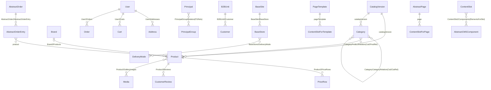

# 機能の設計書: データモデル(型と関連、サンプルデータ)(チケット番号なし。基盤の設計)

読み手: 型や ImpEx を触る人(cs-backend)、OCC の応答の元を知りたい人(cs-frontend、cs-occ-liaison)
状態: 合意済み(2026-10-20)

パスの書き方: リポジトリの最上位からの相対。ただし `core-customize/hybris/bin/` の下は頭を省いて `platform/`、`platform-lite/`、`custom/` から書く。行番号は 2026-10-20 時点。

## 要約(用語なし、3 行まで)
商品、カテゴリ、ブランド、お客様、カート、注文、画面の部品などのデータの形と、そのつながりをまとめる。
形は 2 つの設定ファイルに書いてあり、そこから表が作られる。
試しに使うデータは、決まった手順のスクリプトで毎回同じ中身に作る。

## 何を作るか
### 型の置き場所と、表になるまで
- 標準の型: `platform-lite/resources/platformlite-items.xml`(本物の core / catalog / europe1 / commerceservices / cms2 / b2bcommerce の型のうち、使うものだけを書き直したもの。本物の写しではない)(ソース: `platform-lite/resources/platformlite-items.xml:2-6`)。
- 自社の型: `custom/xyzcore/resources/xyzcore-items.xml`(ソース: 同ファイル 1-81 行)。
- 表の決まり(ソース: `platform-lite/src/de/hybris/platform/lite/persistence/SchemaManager.java:57-125`):
  - どの表にも `pk`(BIGINT)、`typecode`、`createdts`、`modifiedts` の列がある。
  - `deployment` を持たない子の型は、親の表に入る。例: `Cart` と `Order` は `Orders`、`Customer` と `B2BUnit` は `Users`(ソース: `platform-lite/bootstrap/src/de/hybris/bootstrap/typesystem/TypeSystem.java:338`)。
  - 多対多の関連は別の表(`sourcepk`、`targetpk`)になる。1 対多の関連は「多」の側の列になる(推論。多対多だけが別表になることから: `SchemaManager.java:47-53`)。
  - 言語ごとの文字列(`localized:`)とコレクションは JSONB の列。FlexibleSearch の `{name[ja]}` は `->> 'ja'` に読み替える(ソース: `SchemaManager.java:120`、`platform-lite/src/de/hybris/platform/lite/search/FlexibleSearchTranslator.java:352`)。
  - pk は 8796093022209 から数える(ソース: `SchemaManager.java:42`)。

### 主な型
| 型 | 表 | 主な属性 | 定義 |
|---|---|---|---|
| `Catalog` / `CatalogVersion` | `Catalogs` / `CatalogVersions` | `id` / `catalog`+`version`(一意) | `platformlite-items.xml:161-175` |
| `Media` | `Medias` | `code`、`catalogVersion`、`URL`、`mime`、`altText`、`mediaFormat` | 同 176-186 |
| `Category` | `Categories` | `code`、`catalogVersion`、`name`(言語別)、`picture` | 同 187-196 |
| `Product` | `Products` | `code`+`catalogVersion`(一意)、`name`/`summary`/`description`(言語別)、`manufacturerName`、`ean`、`approvalStatus`、`picture`、`thumbnail`、`averageRating`、`keywords` | 同 197-214 |
| `Product`(自社で足した属性) | `Products` | `xyzMaterial`(言語別)、`xyzLaunchDate`、`xyzNewArrival`(動的属性。DB に無い)、`brand` | `xyzcore-items.xml:16-21,54-70` |
| `Brand`(自社) | `XyzBrands` | `code`(一意)、`name`/`description`(言語別)、`logo`、`tier`(既定 STANDARD)、`active`(既定 true) | `xyzcore-items.xml:25-52` |
| `PriceRow` | `PriceRows` | `price`、`currency`、`minqtd`、`net`、`unit`、`product` | `platformlite-items.xml:215-225` |
| `StockLevel` | `StockLevels` | `productCode`+`warehouse`(一意)、`available`、`reserved`、`inStockStatus` | 同 226-235 |
| `CustomerReview` | `CustomerReviews` | `rating`、`headline`、`comment`、`alias`、`user`、`product` | 同 236-245 |
| `Principal` → `User` → `Customer` / `Employee`、`UserGroup` → `B2BUnit` | `Users` | `uid`(一意)、`encodedPassword`、`customerID`、`xyzMemberRank`(自社) | 同 249-304、`xyzcore-items.xml:72-79` |
| `Address` | `Addresses` | 氏名、`line1`、`town`、`postalcode`、`country`、`owner` | 同 282-298 |
| `BaseSite` / `BaseStore` | `BaseSites` / `BaseStores` | `uid`、`contentCatalog` / `productCatalog`、`defaultCurrency`、`net`、`warehouse` | 同 308-328 |
| `DeliveryMode` | `DeliveryModes` | `code`、`name`、`cost`、`active` | 同 329-338 |
| `AbstractOrder` → `Cart` / `Order` | `Orders` | `code`(一意)、`guid`、`user`、`currency`、`status`、`subtotal`、`deliveryCost`、`totalTax`、`totalPrice`、`deliveryAddress`、`deliveryMode`、`paymentInfoCode` | 同 342-373 |
| `AbstractOrderEntry` → `CartEntry` / `OrderEntry` | `OrderEntries` | `entryNumber`、`product`、`quantity`、`basePrice`、`totalPrice`、`order` | 同 374-386 |
| CMS: `PageTemplate`、`ContentPage` / `ProductPage` / `CategoryPage`、`ContentSlot`、`ContentSlotForPage` / `ContentSlotForTemplate`、各コンポーネント | `CMSPageTemplates`、`CMSPage`、`CMSContentSlots` など | `uid`+`catalogVersion`(一意)、`masterTemplate`、`label`、`position` | 同 389-478 |

enum(決まった値の一覧): `ArticleApprovalStatus`、`OrderStatus`(CREATED など 7 つ)、`InStockStatus`、`StockLevelStatus`、`CmsApprovalStatus`、`Gender`、`SiteChannel`(B2C / B2B)、`BrandTier`(STANDARD / PREMIUM / OUTLET)(ソース: `platformlite-items.xml:13-51`、`xyzcore-items.xml:8-14`)。

### 関連の図

(ソース: `platformlite-items.xml:53-116`、`xyzcore-items.xml:16-22`)

- 在庫は商品の参照ではなく、`productCode` と `warehouse` の文字で結ぶ(ソース: `platformlite-items.xml:226-235`)。
- 商品は `electronicsProductCatalog:Online`、CMS は `electronicsContentCatalog:Online` に入る(ソース: `tools/generate-sampledata.mjs:46-54`)。

## 実現の仕方の仕分け
型を足す・変えるのは「OCC の拡張(Commerce 側)」。自社の型は `xyzcore-items.xml` に書く。標準の型に属性を足すときは `autocreate="false" generate="false"` で同じ code の itemtype を書く(ソース: `custom/xyzcore/resources/xyzcore-items.xml:2-5`)。新しい自社の型の typecode は 25000 から使っている(ソース: 同 27 行)。

## 流れ(1 段 1 行。各段の責任)
`./ant initialize` でデータが入るまで。

| 段 | ファイル(行) | クラス / 関数 | 責任 |
|---|---|---|---|
| 1 | `platform/resources/ant/ant-impl.sh:36` | `initialize` | `java -jar build/libs/commerce.jar --hybris.mode=initialize` を呼ぶ |
| 2 | `platform-lite/src/de/hybris/platform/lite/setup/SystemSetup.java:42-49` | `initialize` | スキーマを消して作り直し、`common` → `sampledata` の順に ImpEx を入れる |
| 3 | `platform-lite/src/de/hybris/platform/lite/persistence/SchemaManager.java:31-55` | `dropAll` / `createOrUpdate` | `DROP SCHEMA public CASCADE` のあと、型から表と列を作る |
| 4 | `platform-lite/src/de/hybris/platform/lite/setup/SystemSetup.java:78-92` | `importData` | 拡張の順に `<拡張>/import/<folder>/**/*.impex` を名前の順で読む |
| 5 | `platform-lite/src/de/hybris/platform/lite/impex/ImpExImporter.java:30-40` | `ImpExImporter` | INSERT / INSERT_UPDATE / UPDATE / REMOVE を読み、解けない行は何周か試す。最後まで残ると「unresolved lines」で失敗 |

- 必須データ(言語 ja/en、通貨 JPY/USD、国 JP/US、利用者グループ、`admin`、`anonymous`、敬称)は `platform-lite/resources/platformlite/import/common/essential-data.impex`。`initialize` と `updatesystem` の両方で入る(ソース: 同ファイル 1-31 行、`SystemSetup.java:48,56`)。

### サンプルデータ(`tools/generate-sampledata.mjs` が作る)
乱数の種(20261020)と基準日(2026-10-01、「今日」は 2026-10-20)を固定しているので、何度作っても同じ中身になる(ソース: `tools/generate-sampledata.mjs:20,35-38`)。ImpEx を手で直さず、スクリプトを直して作り直す(ソース: `tools/README.md:26-28`)。

| ファイル | 型と件数(データ行を数えた) |
|---|---|
| `01-catalog.impex` | Catalog 2、CatalogVersion 2、BaseSite 1(`electronics-spa`)、DeliveryMode 2(`standard-gross` 500 円、`premium-gross` 1,200 円)、BaseStore 1(`electronics`、`net=false`) |
| `02-media.impex` | Media 1,000(画像は置かず `/medias/<code>.svg` の URL だけ) |
| `03-categories.impex` | Category 100(上位 10 + 下位 90) |
| `04-brands.impex` | Brand 30 |
| `05-products.impex` | Product 1,000(`XYZ-000001` 〜 `XYZ-001000`) |
| `06-prices-stock.impex` | PriceRow 2,000(JPY と USD)、StockLevel 1,000 |
| `07-b2b-customers.impex` | B2BUnit 100、Customer 1,002(1,000 人 + テスト用 2 人)、Address 1,002 |
| `08-orders.impex` | Order 5,000、OrderEntry 10,009 |
| `09-reviews.impex` | CustomerReview 2,000(全商品に 1 件以上) |
| `10-cms.impex` | PageTemplate 9、ページ 100(ContentPage 97、ProductPage 1、CategoryPage 2)、コンポーネント 500(リンク 203、段落 101、カルーセル 98、バナー 86、Flex 12)、ContentSlot 211、ContentSlotForTemplate 54、ContentSlotForPage 205 |

(実測: 2026-10-20 に `custom/xyzcore/resources/xyzcore/import/sampledata/*.impex` の `;` で始まる行を見出しごとに数えた)

- 商品の価格(JPY)は 980 〜 198,000 円。USD は JPY ÷ 150(ソース: `tools/generate-sampledata.mjs:188,229-230`)。
- 商品の約 5% は発売日が「今日」より後(1 〜 72 日先)(ソース: 同 189 行)。
- テスト用の利用者: `taro@example.com`(B2C)、`hanako@example.com`(B2B、承認者)。パスワードは `Test1234!`(ソース: `tools/README.md:29`)。

## 使う API
データの出口は OCC。一覧は `docs/design/occ-api.md`。

## SSR での扱い
該当なし。

## 翻訳キーと CMS
- 言語別の値は ImpEx の `name[lang=ja]` / `name[lang=en]` で入れる(ソース: `tools/generate-sampledata.mjs:104`)。
- CMS のテンプレートとスロットの位置の一覧は `docs/design/storefront.md` の「ページとスロット」。

## テスト
- `platform-lite/testsrc/de/hybris/platform/lite/ModelServiceIntegrationSpec.groovy` が、言語別の名前・enum・カテゴリ・価格の保存と読み戻し、カートの明細、必須属性と一意の確かめを試す(ソース: 同ファイル 45-132 行)。
- データを作り直したら `./ant initialize` のあと `node tools/occ-smoke.mjs` を通す。

## 根拠の確かさ
- (推論): 1 対多の関連は「多」の側の列として持つ。
- (未確認): `essential-data.impex` の 1 行目の説明に「配送方法」とあるが、配送方法は `01-catalog.impex` に入っている(ソース: `platform-lite/resources/platformlite/import/common/essential-data.impex:1`)。説明の直しが要るかを platform-lite の担当に確かめる。
- (未確認): `xyzLaunchDate` が未来の商品(約 5%)も検索に出る。`docs/design/backend-extensions.md` の「根拠の確かさ」を参照。
